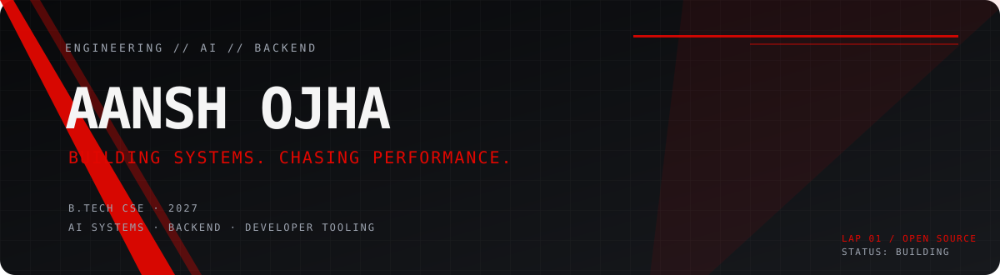

<div align="center">



<br/>

[](https://git.io/typing-svg)

<a href="https://aanshojha.github.io">Portfolio</a> ·
<a href="https://github.com/AanshOjha">GitHub</a> ·
<a href="https://linkedin.com/in/aansh-ojha">LinkedIn</a> ·
<a href="https://leetcode.com/u/aanshojha">LeetCode</a> ·
<a href="mailto:aansh.ojha@outlook.com">Email</a>

</div>

---

### `01 / DRIVER PROFILE`

```text
AANSH OJHA  //  AI & BACKEND ENGINEERING
B.Tech CSE   //  AKTU, 2027
FOCUS        //  AI systems · Backend · Developer tooling
```

I build backend systems and AI-powered products — from multi-source data pipelines and LLM workflows to developer tools that make code reviews less painful.

Exploring the intersection of AI infrastructure, backend reliability, and useful product experiences.

> 🏎️ My code doesn't have to win every race. It just needs to pass the checks before deployment.

---

### `02 / SELECTED BUILDS`

<table>
<tr>
<td width="50%" valign="top">

#### ◉ Yggdrasil AI Workspace
`AI PLATFORM` `MULTI-TENANT` `RAG`

Hybrid semantic cache + BM25 retrieval, conversation memory, modular skill routing, and automated LLM evaluation.

**52% lower response latency · 40% less LLM cost**

`FastAPI` `Redis` `PostgreSQL` `React` `MCP`

[↗ Repository](https://github.com/AanshOjha)

</td>
<td width="50%" valign="top">

#### ◉ AI PR Reviewer
`DEV TOOLING` `GITHUB ACTIONS`

AI-powered pull request reviews with inline comments, merge-safety verdicts, and validated diff-line targeting.

Built to catch the bugs. Not invent line numbers.

`GitHub Actions` `Python` `Azure AI Foundry`

[↗ Repository](https://github.com/AanshOjha)

</td>
</tr>
<tr>
<td width="50%" valign="top">

#### ◉ Algorithmic Trading Platform
`FULL STACK` `BACKTESTING`

Strategy execution and backtesting with configurable indicators and interactive performance analytics.

`FastAPI` `SQLite` `Vue` `Chart.js`

[↗ Repository](https://github.com/AanshOjha)

</td>
<td width="50%" valign="top">

#### ◉ URL Shortener
`BACKEND` `CLOUD`

Base62 short links, Redis caching, analytics, HTTPS, and IP-based rate limiting.

`FastAPI` `PostgreSQL` `Redis` `Azure`

[↗ Repository](https://github.com/AanshOjha)

</td>
</tr>
</table>

---

### `03 / TECH STACK`

<div align="center">

**AI / ML**
<br/>


<br/>

**Backend / Languages**
<br/>


<br/>

**Cloud / Data / Tooling**
<br/>


</div>

<details>
<summary><b>Full skill inventory</b> — expand if you want the technical details</summary>

- **AI/ML:** OpenAI Response API, Gemini, LangChain, LangGraph, RAG, Vector Search, AI Agents, MCP, A2A, Context Engineering, AI Harness, OpenTelemetry, LangSmith, Transformers, ML fine-tuning/optimization, CNNs, RNNs, MLflow
- **Languages:** Python (FastAPI, Pydantic), Java (Spring Boot), JavaScript, SQL, C, Bash
- **Cloud & DevOps:** Docker, Kubernetes, AWS (Lambda, Bedrock, S3, RDS, EKS), Azure (Functions, App Service, Entra ID, Microsoft Foundry, Azure DevOps), Linux, Git, GitHub Actions
- **Databases:** PostgreSQL, MySQL, Redis, Qdrant, ChromaDB, pgvector
- **CS:** DSA, OOP, REST APIs, multithreading, asynchronous programming, distributed systems, database design, system design

</details>

---

### `04 / TELEMETRY`

<div align="center">


<br/>


</div>

---

### `05 / TRACK ACTIVITY`

<div align="center">


</div>

---

### `06 / OFF THE CLOCK`

```text
TEAM RADIO:
"Can you make it faster?"

ME:
"Have you tried adding a cache?"
```

F1 fan. Story-game enjoyer. Probably debugging something that worked five minutes ago.

<sub>Thanks for stopping by the garage. Feel free to explore the repos, open an issue, or say hello.</sub>

<div align="center">


**BUILD · SHIP · REPEAT**

</div>
