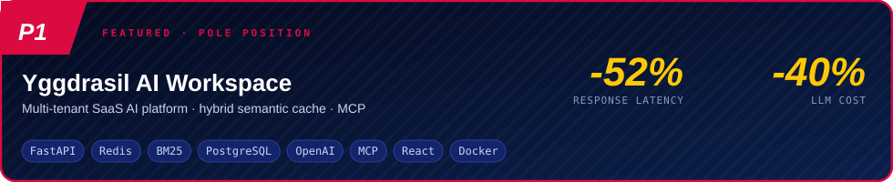
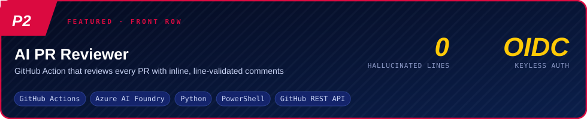
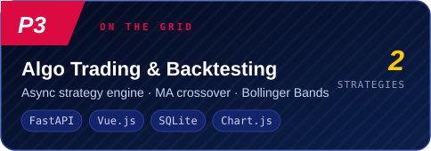
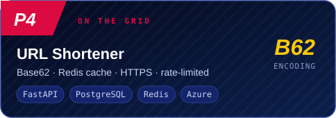

<div align="center">



<br/>

<a href="https://readme-typing-svg.demolab.com">
  
</a>

<p>
  <a href="https://www.linkedin.com/in/aansh-ojha"></a>
  <a href="https://drive.google.com/file/d/1tcT59n6Jcg9sSo8KcQUq2SYF87ujzKuH/view?usp=drive_link"></a>
  <a href="https://leetcode.com/u/aanshojha"></a>
  <a href="https://aanshojha.github.io"></a>
</p>

</div>


<!-- ───────────── RECRUITER FAST LANE ───────────── -->
<div align="center">

### 🏁 Pit Lane: the 60-second tour

| Lap | Where | What you'll see |
|:---:|:------|:----------------|
| **1** | [Starting Grid ↓](#grid) | Four projects, two of them flagship |
| **2** | [Telemetry ↓](#telemetry) | The stack, no fluff |
| **3** | [Race Log ↓](#racelog) | Backend + AI work at SmartCard AI |
| **4** | [Lap Times ↓](#laptimes) | Live GitHub + LeetCode stats |
| **🏆** | [All repositories →](https://github.com/aanshojha?tab=repositories) | Full garage |

</div>

<br/>

<a id="profile"></a>


```python
class Aansh:
    role      = "AI Backend Engineer"
    based_on  = "FastAPI · Python · Azure"
    obsessed  = ["RAG", "AI agents", "MCP", "ETL pipelines", "latency charts that go down"]
    education = "B.Tech CSE, 2027 · GPA 8.1"
    fuel      = "coffee + clean diffs"

    def pit_strategy(self, problem):
        return "cache it, measure it, then ship it"
```

> 🏎️ I build backends that talk to LLMs, and make sure they answer fast and don't hallucinate their way into production.
> Think of it as *engine tuning*, but the engine is a data pipeline and the fuel is tokens.

<br/>

<a id="telemetry"></a>


<div align="center">


<br/>


<br/><br/>

| 🧠 **AI / ML** | |
|:--|:--|
| **Models & SDKs** | OpenAI Responses API · Google Gemini · Transformers |
| **Orchestration** | LangChain · LangGraph · AI Agents · MCP · A2A Protocol |
| **Retrieval** | RAG · Vector Search · Qdrant · ChromaDB · pgvector |
| **Ops & Evals** | LangSmith · OpenTelemetry · MLflow · LLM-as-a-Judge |

| ☁️ **Cloud & Backend** | |
|:--|:--|
| **AWS** | Lambda · Bedrock · S3 · RDS · EKS |
| **Azure** | Functions · App Service · Entra ID · Microsoft Foundry · Azure DevOps |
| **Core CS** | DSA · OOP · Distributed Systems · System Design · Async & Multithreading |

</div>

<br/>

<a id="grid"></a>


<div align="center">

<a href="https://github.com/aanshojha/yggdrasil-ai-workspace">
  
</a>

<sub>Hybrid semantic caching (embeddings + BM25), LLM-as-a-Judge evals on an hourly Azure Functions trigger, per-user memory, skill routing, GitHub MCP, streaming. Latency went from 18.39s to 8.74s. Pit stop completed.</sub>

<br/><br/>

<a href="https://github.com/aanshojha/ai-pr-reviewer">
  
</a>

<sub>Parses the git diff, works out which lines are valid comment targets, and re-checks every AI suggestion against that set. No ghost line numbers. Drop-in GitHub Action template for any repo.</sub>

<br/><br/>

<table>
<tr>
<td width="50%" align="center">
  <a href="https://github.com/aanshojha/algo-trading-backtesting-platform"></a>
</td>
<td width="50%" align="center">
  <a href="https://github.com/aanshojha/url-shortener"></a>
</td>
</tr>
</table>

</div>

<br/>

<a id="racelog"></a>


**🏎️ AI Backend Intern · SmartCard AI** &nbsp;·&nbsp; *Nov 2025 → Present · Remote*

- 🔧 **Universal File-to-SQL ETL.** Infers schema on the fly and auto-creates normalized MySQL tables from SQL DBs, MongoDB, Snowflake, spreadsheets and PDFs. One unified REST API sits on top.
- 🧩 **Modular connectors** for databases, files, images, audio, video and live Google Sheets, feeding a model that generates charts, heatmaps, scorecards and SQL cards from plain-English prompts.
- 🚀 **24-hour refresh pipeline + CI/CD** with GitHub Actions deploying to Azure. Dashboards stay fresh without anyone pressing a button.

**🎓 B.Tech, Computer Science & Engineering** &nbsp;·&nbsp; *2023 → 2027 · Dr. A.P.J. Abdul Kalam Technical University, Lucknow · GPA 8.1*

<br/>

<a id="laptimes"></a>


<div align="center">


<br/>

<a href="https://leetcode.com/u/aanshojha">
  
</a>

<sub>200+ problems solved. Time complexity is the only race where lower is faster.</sub>

</div>

<br/>

<a id="paddock"></a>


<div align="center">

| | |
|:-:|:-:|
| 💼 [**LinkedIn**](https://www.linkedin.com/in/aansh-ojha) | 📄 [**Resume (PDF)**](https://drive.google.com/file/d/1tcT59n6Jcg9sSo8KcQUq2SYF87ujzKuH/view?usp=drive_link) |
| 🧮 [**LeetCode**](https://leetcode.com/u/aanshojha) | 🌐 [**Portfolio**](https://aanshojha.github.io) |

<br/>


<sub>🏁 *"Simply lovely."* is what I say when CI goes green on the first push.</sub>
<br/>
<sub>Built with SVG, caffeine and a slightly unhealthy interest in F1</sub>

</div>
